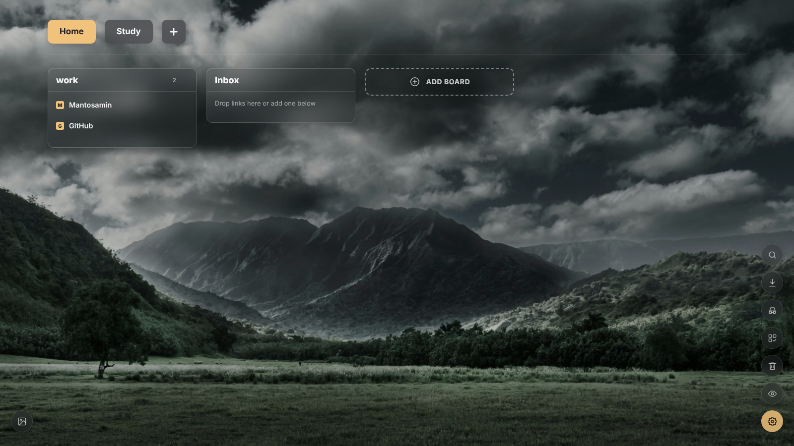

# LinkBoard

A visual, drag-and-drop bookmark manager that replaces Chrome's new tab page. Frosted-glass boards over a wallpaper, organized into pages. Everything is stored locally in your browser — no account, no server.

## Features

- **Pages & boards** — group links by project or topic; rename with a double-click
- **Drag & drop** — reorder links and boards, move links between boards, drop a link on a page tab to move it there, or drag a URL straight from the address bar
- **Quick save** — `Ctrl+Shift+Y` (`Cmd+Shift+Y` on macOS), the toolbar icon, or the right-click menu saves the page into an *Inbox* board
- **Search** — press `/`; filter by all pages, current page, or board names, with exact-match mode
- **Import / export** — Chrome bookmarks, browser bookmark `.html` files, `.txt` link lists, JSON backups
- **Bulk select** — move, open, or delete many links at once
- **Trash** — deleted links, boards, and pages can be restored (plus instant Undo)
- **Privacy blur** and **Incognito mode** for opening links privately
- **Customization** — built-in wallpapers or your own, darken/blur controls, accent color, board width

## Install

1. Download or clone this repo.
2. Open `chrome://extensions` and turn on **Developer mode**.
3. Click **Load unpacked** and choose this folder.
4. Open a new tab. If Chrome asks "Change back to Google?", choose **Keep it**.

> Only one extension can replace the new tab page, so disable any other new-tab extension.

## Notes

- Incognito opening requires enabling **Allow in Incognito** on the extension's details page.
- If `Ctrl+Shift+Y` is taken by another extension, change it at `chrome://extensions/shortcuts`.
- Site logos load from Google's and DuckDuckGo's favicon services, falling back to Chrome's favicon cache.

## License

MIT
